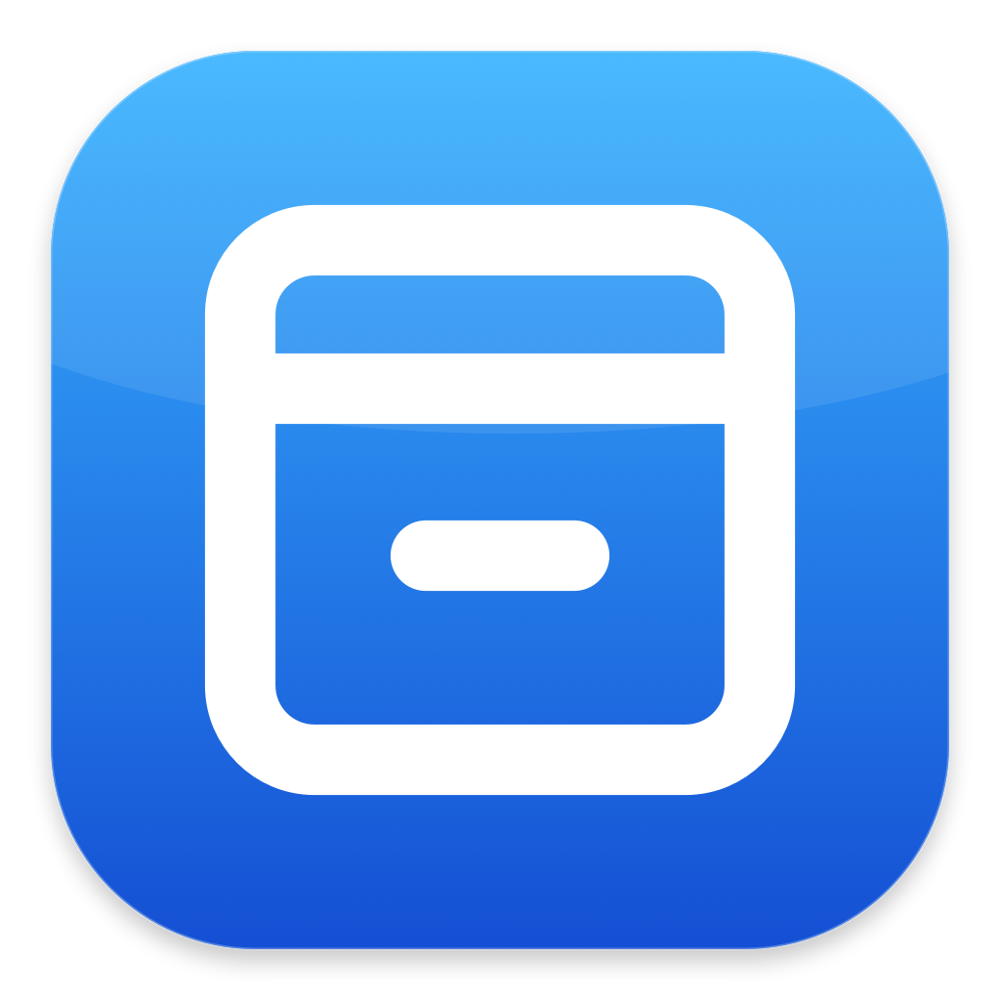

<p align="center">
  
</p>

<h1 align="center">Bar</h1>

<p align="center">给 macOS 菜单栏一个抽屉。</p>

<p align="center">
  收纳不常用的图标，让常用图标按你的顺序排列。
  <br>
  macOS 27.2+ · Swift · AppKit · SwiftUI
</p>

<p align="center">
  <a href="docs/usage.md">使用指南</a> ·
  <a href="docs/system-icons.md">系统图标</a> ·
  <a href="docs/development.md">构建与开发</a>
</p>

## 功能

- **收纳与常显**：每项选择留在菜单栏，或收进抽屉；也可以忽略，交给系统显示。
- **左右分组与排序**：分别管理 Bar 两侧的图标，常显项目也能排序。
- **按习惯展开**：点击、悬停自动开合，或保持抽屉展开；左栏支持向左或向下展开，右栏在下方展开。
- **记住你的选择**：分区、顺序和收纳规则自动保存，应用或 Bar 重启后继续使用。
- **贴近系统外观**：抽屉使用真实菜单栏图像，单色图标随背景调整黑白对比度。

## 快速开始

需要 **macOS 27.2 或以上**、包含 macOS 27 SDK 的 Xcode，以及 Swift 6.2 或以上。

```sh
git clone https://github.com/liuchong/bar.git
cd bar
bash scripts/install.sh
open -a Bar
```

安装脚本会构建、签名并安装应用，需要本机可用的 Apple Development 签名身份。更新前先退出正在运行的 Bar。其他签名方式和构建选项见[开发指南](docs/development.md)。

首次打开后，在设置中允许**辅助功能**；要在抽屉里显示原来的菜单栏图像，还需允许**屏幕录制**。Bar 只读取菜单栏和抽屉所在的窄条图像，不录音、不联网，图像仅在本机内存中处理。

## 常显、收纳、忽略有什么区别？

| 图标去向 | 行为 |
| --- | --- |
| 菜单栏常显 | 保留原生图标，Bar 管理其分区和顺序。 |
| 收纳到抽屉 | 点击 Bar 展开抽屉，再点图标打开原来的菜单或窗口。 |
| 忽略 | 保留系统显示，统一放在 Bar 右侧，不参与自定义排序。 |

所有图标与抽屉设置都在**图标**页；**通用**页负责登录启动、暂停管理和权限。未检测到菜单栏图标的应用会保留规则，图标出现后再应用收纳，不会在展开抽屉时自动启动应用。

## 文档

| 文档 | 内容 |
| --- | --- |
| [使用指南](docs/usage.md) | 权限、左右栏、抽屉开合、规则保存和常见问题。 |
| [系统图标](docs/system-icons.md) | 管理开关、支持范围、系统固定入口和显隐边界。 |
| [构建与开发](docs/development.md) | 签名安装、代码结构、实现方式、测试与验证范围。 |

Bar 使用当前 macOS 的私有菜单栏接口，系统更新可能影响显隐与排序行为。接口不可用或位置整理失败时，会保留原生显示；具体限制见[系统图标说明](docs/system-icons.md#当前边界)。
